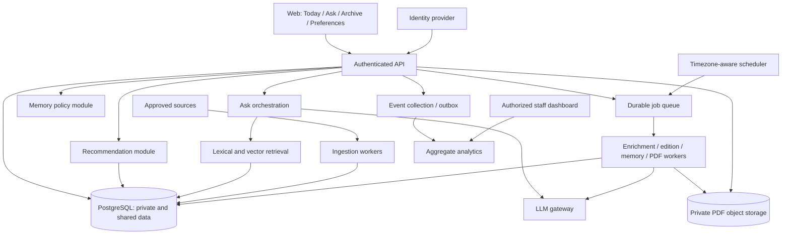

# Dayfold: product and architecture specification

Version: 0.4 — MVP implementation underway; live database validation pending  
Date: 17 October 2026  
Status: implementation baseline; coding authorized by the user. Implementation and verification evidence are tracked in TODO.md and docs/implementation-status.md. Performance targets below remain targets, not achieved capacity claims.  
Working name: Dayfold (branding unconfirmed)

## 1. Purpose and decision status

Build a personal daily newspaper that reduces the effort of finding and understanding relevant developments. Readers get a finite, sourced edition, can investigate news conversationally, and can control the preferences that shape future editions.

This is a startup MVP with production-oriented boundaries, not a collection of demo-only AI features. Scale, security, recommendation quality, and unit economics must be measurable. Frontend implementation follows this specification; the visual identity is not finalized.

Status vocabulary:

- **Required:** specified by the supplied challenge or explicitly requested by the user.
- **Proposed:** an engineering or product decision recommended here, subject to evidence.
- **Unresolved:** insufficient information to choose responsibly.

### Required scope

- Accounts and persistent user data.
- Interest onboarding, with ten proposed questions whose answers each affect recommendations or presentation.
- A fresh daily edition, complete web reading experience, matching newspaper-inspired PDF, original-source links, skip controls, and historical editions.
- Recommendations that improve through feedback and appropriately interpreted behavior.
- An Ask tab for personalized, sourced news queries.
- Structured extraction of memory candidates from conversation, with controlled persistence.
- A second useful LLM capability: proposed here as “What changed since I last read?”
- Internal analytics for product learning, operating costs, and later monetization experiments.
- Familiar navigation, accessible reading, and restrained animation.
- Security and scalability considered from the first usable version.

Challenge submission requirements remain a separate delivery checklist: a repository created at the start of the hackathon, public repository link at submission, a product video of at most five minutes, and an architecture diagram. This document does not create a repository or authorize publication.

### Working assumptions and unresolved inputs

- Initial experience is a responsive web application. Native mobile applications are outside the first release.
- One primary edition per reader-local calendar day; default availability at 07:00 in the user's selected timezone is proposed, not confirmed.
- Initial reading budgets are 5, 10, and 15 minutes; actual text length uses a documented reading-speed estimate.
- Initial audience: general news readers in South Asia, with the product intended to remain useful globally. This is a broad market definition; initial reading needs still need prioritization.
- Service constraint: Vercel and Supabase free tiers for the MVP. User reports existing Google Cloud credits and prior successful use of Gemini 3.7/3.8 through Agent Platform. Treat model access as user-reported, not independently tested; model routing, quotas, and credit consumption remain to be checked without exposing credentials.
- Planning has no time constraint per the user's later instruction. Earlier three/six-hour estimates are historical context and must not drive scope cuts or performance claims.
- Deployment: the user will deploy the application on Vercel. Background execution and free-tier service limits must be verified before choosing job infrastructure.
- Launch languages: English and Urdu, confirmed by the user. Urdu requires right-to-left interface and PDF support, appropriate fonts and shaping, and separate language-quality evaluation. Hindi is outside the confirmed initial scope.
- Reading language is independent of geographic preferences. Preserve original-source links and label translated briefs. Ground translated summaries in available source text; evaluate names, dates, numbers, and meaning in both languages. Store canonical topic/entity identifiers independently of output language.
- The local `.env` was inspected for variable names only with user authorization. Names indicate Gemini, Supabase/database, SMTP, and Google service-account configuration; credential validity, permissions, quotas, and connectivity have not been tested. Never copy credential values into documentation, client bundles, or logs.
- Source coverage, hosting/data region, and team capacity remain unresolved. No application implementation begins until the user and agent have clarified the material product and architectural decisions.
- Use a single initial deployment region; no claim of global low latency or regulatory compliance is made.
- The free launch and later optional paid tier are a strategy hypothesis, not validated willingness to pay.
- Eynvision is business context, not an approved visual reference or a source of product requirements.

## 2. Product promise and boundaries

**Promise:** “Understand what matters to you today, with enough context to trust it and a clear point at which you are done.”

The primary success outcome is a useful, repeatable reading habit. Time on site and click volume are not sufficient measures of value. The system must not maximize engagement by increasing alarm, repetition, or ideological reinforcement.

### Initial navigation

- **Today:** dated edition, lead story, topic sections, reading estimate, source links, feedback, and PDF action.
- **Ask:** conversation, cited answers, related coverage, and visible memory-update notices.
- **Archive:** saved editions by date; original content and download status.
- **Preferences & Memory:** topics, reading settings, explicit interests, inferred memories, editing, forgetting, and memory controls.
- **Account:** authentication, timezone, privacy choices, account export/deletion.
- **Internal analytics:** separate staff-only interface with aggregate product, quality, reliability, and cost views.

Welcome and onboarding precede the main app. Story detail can expand inline or in a panel; a dedicated page is not essential. Each story must have a stable address for navigation and sharing only when its visibility permits it; private editions must not become publicly accessible through story links.

### UX rules

- Use familiar navigation and standard controls. Establish typography, spacing, and interaction consistency before decorative effects.
- Prioritize comfortable mobile reading and keyboard access. Honor reduced-motion preferences.
- Show source and date context next to claims; make freshness and partial coverage visible.
- Never imply that an opened article was understood, that an inferred preference is confirmed, or that a stale edition is today's edition.
- Memory updates are inspectable and reversible. Feedback is optional and does not repeatedly interrupt reading.
- A finite edition has an end state. Additional discovery is a deliberate action.

## 3. Onboarding contract

Ten questions are a proposed maximum, presented across short steps with progress, back navigation, and skips. Proposed completion target: median under two minutes in usability testing. Answers remain editable. Deeper questions describe reading preferences, not a psychological diagnosis or personality score.

1. **Which subjects matter to you?** Multi-select topics. Sets explicit topic weights used in retrieval and ranking.
2. **Which places should we cover?** Optional regions. Adds geographic relevance without requiring precise location.
3. **Which industries, organizations, or people do you follow?** Optional entity selection/search. Adds entity candidates and ranking signals.
4. **How long would you like to read?** Reading budget. Controls edition length and story allocation.
5. **Which language do you prefer?** Language eligibility and presentation. Only offer supported languages; do not promise automatic translation before validation.
6. **What do you want news to help you do?** Understand events, support work, learn, or explore. Adjusts content-purpose weights, not factual conclusions.
7. **How much background do you want?** Concise versus contextual explanation. Controls brief depth and selection of explanatory coverage.
8. **How much unfamiliar material would you like?** Low, medium, or high discovery. Controls a bounded exploration share.
9. **Early coverage or stronger confirmation?** Controls eligibility of uncertain developing stories; uncertainty remains labeled in all modes.
10. **How often should ongoing stories return?** Major changes only or meaningful incremental updates. Controls follow-up thresholds.

For skipped answers, use documented neutral defaults. Do not infer sensitive traits to fill gaps. A question ships only when its corresponding effect is implemented and tested. Measure step abandonment and compare a shorter onboarding variant before requiring all ten answers.

## 4. Principal flows

### 4.1 Account and first edition

1. User authenticates through the selected identity provider. Backend derives identity from the verified session.
2. User selects timezone, completes or skips onboarding, and chooses conversational-memory behavior with a plain-language explanation.
3. Backend saves a versioned preference profile and requests an edition with an idempotency key.
4. A worker retrieves available eligible content and builds the edition. The UI shows queued/generating state.
5. Publish a complete edition atomically. If coverage is insufficient, show the limitation and offer preference adjustment; do not fabricate coverage.
6. PDF generation follows publication and can retry independently.

Authentication method/provider, supported regions, and email delivery are implementation decisions still to be selected. Passwords must be handled by a vetted identity system, not custom password logic.

### 4.2 Daily edition and reading feedback

1. Scheduler resolves the reader's local edition date and queues generation before availability time.
2. Worker uses a content cutoff and a frozen preference version for reproducibility.
3. Retrieval, ranking, and composition produce a stored edition with source references and recommendation reasons.
4. Reader opens stories, follows source links, marks already read, or provides more/less feedback.
5. Backend records deduplicated events. Explicit corrections take precedence; future ranking reflects accepted updates.
6. Web and PDF render the same edition snapshot. A retry must not overwrite a published edition with different selections.

Do not proactively generate daily editions for every dormant free account indefinitely. Proposed initial policy: pre-generate for recently active readers, generate on return for others; define activity window through cost and usage evidence. Daily availability promises must disclose the selected policy.

### 4.3 Ask and conversational memory

1. Validate session, request size, rate allowance, and conversation ownership.
2. Retrieve a bounded set of relevant preferences, accepted memories, and recent story exposure. Current explicit query overrides general historical preferences.
3. Parse time/topic constraints and retrieve authorized news content using lexical and semantic search.
4. Generate an answer grounded in retrieved evidence; provide source references and coverage timestamps. Say when evidence is insufficient.
5. Run structured memory extraction for the user turn, returning zero or more candidates. This is asynchronous relative to answering; failure must not discard a good answer.
6. Validate candidates, apply the memory policy, and persist accepted changes transactionally. Record extraction version and supporting message reference.
7. Display what changed in memory with undo/edit access. Proposals requiring confirmation remain pending until accepted.

The answer and extractor share the same authorized request context but have separate responsibilities. The extractor examines user statements, not article instructions or assistant-generated preferences. It has no database-write tool. A second model call is the proposed initial implementation for isolation and independent retries; its added latency/cost is measured. Combining outputs later requires equivalent validation and evaluation.

### 4.4 “What changed?”

1. Resolve a story cluster and a baseline the reader explicitly selects or previously opened/marked read.
2. Retrieve evidence available at the baseline and later developments, preserving publication and discovery timestamps.
3. Generate a cited difference brief: previous state, new development, remaining uncertainty.
4. If no material development is supported, say so. New wording or another outlet repeating a claim is not a development.
5. Show the baseline date. If exposure is uncertain, use “Since the edition you opened,” not “Since you learned.”

Compute reusable story-level change summaries where possible; select the appropriate interval per reader. Version and invalidate derived summaries when evidence changes or corrections arrive. Do not infer causality or the user's beliefs.

### 4.5 Archive, corrections, and deletion

- Archives load stored editions, not a new ranking against today's preferences.
- Published snapshots remain stable, but visible correction notices and source retractions must be supported. Label a regenerated corrected PDF as a revision; do not silently alter history.
- Rights removal may require disabling content despite snapshot immutability. Keep permitted metadata and a removal notice rather than continuing to distribute restricted content.
- Account deletion revokes sessions, stops scheduled jobs, and initiates deletion of private editions, PDFs, conversations, memories, and attributable events. Backup expiry follows a disclosed policy.

## 5. Recommendation design

### Content preparation

Maintain an approved source registry with access method, content permissions, fetch limits, language, and provenance. Use feeds/APIs where appropriate. Fetching a page successfully does not establish republication rights. Full-text storage and redistribution require a source-specific decision; store only permitted content.

Normalize URL, title, publisher, publication/update/fetch times, language, excerpt/body availability, entities, and topics. Track extraction quality. Deduplicate exact items and cluster coverage of the same event with conservative thresholds; allow cluster corrections. Never treat embedding similarity alone as proof that two factual claims agree.

### Candidate retrieval

Union candidates from explicit topics/entities, semantic interests, geographic relevance, ongoing story updates, and bounded discovery. Filter unavailable, unsupported-language, stale-for-purpose, and blocked items. The Ask flow additionally uses lexical retrieval for precise names and current query constraints.

Proposed experimental starting size: retrieve up to 200 candidates per edition, then measure recall and latency. This is a tunable limit, not a proven optimum.

### Ranking and composition

Use a versioned, interpretable scoring model initially. Features include explicit topic/entity match, semantic similarity, freshness appropriate to content type, useful novelty, deliberate feedback, and transparent source-quality criteria. Do not claim an objective automated truth score.

Composition enforces reading budget, topic/source variety, maximum repeated coverage of a cluster, and limited exploration. Source variety is not false balance: disagreement does not imply equal evidential strength.

Record feature contributions, candidate set/version, selected items, exclusions, and ranking version with appropriate retention. “Why this?” explanations must derive from real features. Avoid publishing sensitive memory values in explanations.

### Learning policy

- Explicit preference edits and “less like this” outweigh a click.
- “Already read” suppresses repetition, not the topic.
- Dwell time and scrolling are weak, noisy signals; hidden-tab time is not reading time.
- Decay temporary interests; cap the effect of repeated events; maintain exploration.
- Start with content-based ranking. Evaluate collaborative signals or learned ranking only after sufficient exposure-labeled data exists.
- Log impressions and position to recognize exposure bias. Offline historical clicks alone cannot establish causal improvement.
- Version profiles and models so regressions can be reproduced and rolled back.

## 6. Memory policy and structured contract

Separate four concepts: explicit preferences, accepted conversational memories, short-lived session intent, and behavioral aggregates. Do not collapse all four into a free-form profile prompt.

Example extractor output (illustrative, not a user fact):

```json
{
  "schema_version": "1",
  "candidates": [
    {
      "operation": "upsert",
      "kind": "topic_interest",
      "value": "battery research",
      "scope": "ongoing",
      "explicit": true,
      "evidence_message_id": "message_example",
      "evidence_quote": "Include battery research in my daily paper",
      "confidence": 0.96,
      "suggested_expiry_days": null
    }
  ]
}
```

An empty `candidates` array is valid and expected. Model confidence is not a calibrated probability or permission to store data. Server code supplies owner ID, timestamps, canonical identifiers, expiry limits, and allowed operation targets. Deletion proposals cannot reference arbitrary database records.

Acceptance rules:

- Explicit nonsensitive ongoing preferences may auto-save when memory is enabled, with a visible notice and undo.
- Ambiguous, temporary, quoted, hypothetical, third-party, or negated statements must not become durable interests automatically.
- Do not infer sensitive identity or health/political/religious traits. Requests to follow a topic are distinct from claims about identity; potentially sensitive durable preferences require explicit confirmation and appropriate controls.
- New explicit corrections supersede old values with provenance. Reprocessing an older turn cannot resurrect a deleted or superseded memory.
- Validate evidence against the authorized user message, schema, canonical topic vocabulary, policy, and profile version.
- Use idempotent extraction IDs and optimistic concurrency. A user edit wins over stale background extraction.
- Deleting a message invalidates memories derived solely from it; forget actions create a suppression mechanism so replay does not restore them.
- Define bounded session-intent expiry and durable-memory review/expiry policies before public release.

Prompt boundaries: system/developer policy is application-owned; query, memories, and retrieved articles are separately delimited untrusted data. Instructions inside news content cannot change policy, request secrets, invoke tools, or authorize writes. The answer contract requires supported claims, valid supplied source IDs, uncertainty disclosure, and no fabricated personal facts. Prompt construction is only one defense, not an authorization boundary.

## 7. System architecture

Proposed baseline: a modular application backend with independent background workers, a relational database, durable queue, and object storage. Avoid independent microservices until operational or scaling evidence justifies extraction.



### Module contracts

- Identity/session module resolves authenticated identity and account lifecycle.
- Content module owns source access, normalized articles, versions, and story clusters.
- Recommendation module accepts a profile version and content cutoff; returns ranked selections with reason codes.
- Edition module owns immutable publication, composition, and PDF revision linkage.
- Ask module coordinates retrieval and grounded response generation; cannot authorize cross-user reads.
- Memory module alone applies proposed profile changes under policy.
- Analytics module measures behavior and costs; its aggregate output is not a substitute for personalization records.
- LLM gateway records model/prompt version, token usage, timeout, validation outcome, and cost estimate without routinely logging private prompts.

Initial candidates are PostgreSQL with full-text/vector extensions, a managed identity provider, managed durable queue, and S3-compatible private object storage. Exact frameworks, services, models, and vendors remain undecided until deployment constraints, pricing, supported features, and corpus tests are checked.

### Example API surface

- `GET /me`, `PATCH /me/preferences`, `GET /me/memories`, `PATCH/DELETE /me/memories/:id`
- `GET /editions/today`, `GET /editions`, `GET /editions/:id`, `POST /editions/:id/pdf`
- `POST /feedback`, `POST /conversations`, `POST /conversations/:id/messages`
- `GET /stories/:id/changes?baseline=...`, `POST /me/export`, `DELETE /me`

These are conceptual contracts. Ownership is always derived and checked server-side; possession of an ID is insufficient. Mutating retryable endpoints accept idempotency keys. Long jobs return job state rather than keeping an HTTP request open. PDF access uses short-lived signed URLs after ownership verification.

## 8. Data model and trust boundaries

### Shared content records

- `sources`: approved access method, policy, language, fetch health.
- `articles` and `article_versions`: canonical URL, publisher timestamps, provenance, permitted text, extraction status.
- `story_clusters` and memberships: event grouping with versioned corrections.
- `content_enrichments`: topics, entities, embeddings, summaries, model/prompt/content version.
- `story_developments`: supported changes and evidence references.

### Private user records

- `users`: identity-provider subject, timezone, account state; minimal necessary personal data.
- `preference_versions`: explicit onboarding/settings values and version.
- `memories`: typed value, scope, provenance, status, expiry, revision, deletion/suppression state.
- `conversations`, `messages`, `memory_candidates`: user ownership and retention state.
- `interaction_events`: exposure, action, object, event ID, event time, schema version.
- `editions`, `edition_items`: local date, timezone, content cutoff, preference/ranker versions, frozen content and source references.
- `pdf_artifacts`: edition revision, private storage key, status, checksum.
- `job_runs`, `usage_ledger`, `audit_events`: execution status, cost attribution, and sensitive administrative actions.

Proposed publication uniqueness: one primary edition per `(user_id, local_edition_date)`. Record timezone-at-generation; timezone changes do not rewrite historical keys. Corrections use explicit revisions. Use foreign keys and transactions rather than relying on prompts or application convention for consistency.

### Boundaries and access

1. **Browser → API:** validate all input; verify session and object ownership; secure cookies and CSRF protection where cookie-based authentication is used.
2. **API → private database:** tenant-scoped queries and database-level row isolation where supported; privileged worker credentials remain separate from public application credentials.
3. **Content → model:** treat text as untrusted, strip unsafe markup, constrain tools, and limit context. No article can authorize memory changes.
4. **Model → application:** validate output schema and source references; never execute generated SQL, arbitrary URLs, or proposed operations directly.
5. **Application → provider:** send minimum relevant context under the selected provider's retention/data-use settings. Resolve region and data-processing requirements before launch.
6. **Analytics → staff:** aggregate access by role, audit sensitive queries, exclude raw conversations and sensitive interest labels from ordinary dashboards.
7. **Storage → reader:** private objects, scoped signed access, no public personalized PDFs or shared personalized-response cache.

Additional controls: TLS, managed encryption at rest, secret management, dependency/security checks, account and endpoint rate limits, administrative MFA, audit trails, backup restoration tests, and incident procedures. Source fetching must block private-network destinations and revalidate redirects to reduce SSRF risk. Sanitize rendered content and PDF inputs; isolate PDF rendering and restrict remote asset fetching.

## 9. Scalability and operating economics

Shared enrichment cost grows primarily with unique articles; personalized retrieval/composition grows with active readers; Ask cost grows with queries. Avoid generating an article summary separately for every user. Cache shared artifacts by content/model/prompt version; personalized cache keys include owner and relevant profile/version constraints.

Workers scale independently by queue depth and job age. Apply per-source limits and model concurrency budgets, bounded retries, backpressure, and dead-letter handling. A spike in PDF generation must not exhaust interactive Ask capacity.

Use paginated archives, indexed owner/date queries, bounded candidate sets, batched embedding work, and connection pooling. Introduce separate vector infrastructure or event storage only when measurements show the shared database is a bottleneck.

Provisional load-test envelope, not a capacity claim: 10,000 registered users, 1,000 daily active readers, 10,000 incoming articles/day, and 50 concurrent interactive sessions. Test forecast peak plus 2x peak; revise these assumptions after audience and source decisions. Spread scheduled work within a delivery window rather than creating a simultaneous midnight burst.

Track:

- Direct cost per successfully published edition, including a share of ingestion/enrichment/PDF work and failures.
- Direct cost per successful Ask response and per accepted memory update.
- Monthly infrastructure and provider cost per active reader.
- Cost by feature, model, and version; separate estimated provider costs from reconciled invoices.

Free-launch abuse limits and budgets must exist even without billing. A later paid feature is selected using repeat value, willingness to pay, retention impact, and margin—not frequency alone. Security, deletion, and memory controls are not paid upgrades.

## 10. Failure behavior and consistency

- **One source fails:** bounded retries with jitter; continue other sources; record coverage degradation. Honor source rate limits and retry guidance.
- **Insufficient eligible news:** publish a clearly labeled smaller edition only if minimum usefulness criteria are met; otherwise expose unavailable status and retain dated prior editions. Never pad with fabricated or silently stale content.
- **Model timeout/unavailability:** core reading remains available. Use existing validated enrichment or clearly labeled source excerpts where permitted; Ask reports inability to synthesize and may show retrieved links.
- **Malformed or ungrounded model output:** reject; permit one bounded repair attempt; fall back without persisting invalid content or memory.
- **Memory extraction fails:** preserve the answer; mark extraction pending/failed; retry idempotently. Do not claim memory was saved until committed.
- **Contradictory memory:** explicit latest user correction wins; ambiguous conflicts remain proposals. Stale background work cannot overwrite newer versions.
- **Edition worker crashes:** lease/retry the job; unique publication key prevents duplicate editions; no partially published edition becomes visible.
- **PDF fails:** web edition remains readable; show retry state; reuse the frozen edition for regeneration.
- **Database unavailable:** fail private mutations clearly; do not pretend feedback or memory was saved. Never bypass ownership checks for availability.
- **Queue backlog:** show pending state and delivery delay, prioritize interactive work, alert on oldest job age, and apply admission limits.
- **Analytics unavailable:** core reading continues; use bounded buffering or drop noncritical telemetry with a recorded loss counter. Do not block content serving indefinitely.
- **Source retracts/corrects a story:** invalidate affected derived content, add a correction notice, and generate explicit revisions where needed.
- **Deletion races with jobs:** workers check account/deletion state before reading and committing; revoke artifacts and cancel future scheduling.

Job states: queued, running, succeeded, retryable-failure, terminal-failure, canceled. Edition states: pending, building, published, unavailable; PDF status is independent. Retry counters and terminal errors must be visible to operations staff.

## 11. Evaluation and release criteria

All thresholds below are proposed targets, not measured results. Fix datasets and rubric versions before comparing implementations; do not tune on the held-out evaluation set.

### Recommendation quality

- Assemble at least 30 varied reader profiles and 300 candidate story judgments across topics, geography, cold-start, sparse coverage, and conflicting signals. This is an initial diagnostic set, not sufficient population-level validation.
- Collect graded relevance judgments with a defined rubric and review disagreements. Evaluate the same candidate corpus against a fresh-topic baseline.
- Report NDCG@10, relevance precision@10, retrieval recall on labeled relevant items, duplicate-cluster rate, coverage, and worst-performing cohorts.
- Proposed gate: at least 10% relative NDCG@10 improvement over baseline, with uncertainty reported and no unexplained material cohort regression. Small samples require more evidence rather than marketing a conclusive win.
- Composition checks: respect explicit exclusions and supported language, avoid duplicate event coverage unless deliberately grouped, and fit reading budget within 20% using the documented estimate.

### Grounded answers and change briefs

- Build at least 100 cases spanning answerable/unanswerable questions, conflicting reports, date constraints, stale sources, article prompt injection, and genuine versus superficial story changes.
- Human rubric: factual support, citation entailment, coverage of the question, temporal correctness, and appropriate uncertainty.
- Proposed gate: 100% citation references resolve to supplied evidence, at least 95% of sampled factual claims are supported, and no critical fabricated claim in the release set. Citation existence alone is insufficient.
- Unanswerable cases must not produce confident unsupported answers. Change briefs must identify their baseline and support each asserted development.

### Memory correctness

- At least 100 adversarial/ordinary turns: explicit interest, temporary research, negation, quotation, third-party statements, sensitive inference, deletion, corrections, replay, and concurrent updates.
- Proposed gate: at least 95% precision for automatically persisted candidates; track recall separately. No unauthorized cross-user write, sensitive inference auto-save, or resurrected deleted memory in the release suite.
- Verify preferences actually influence ranking and explanations. A correct JSON object without the intended downstream effect does not pass.

### Security and reliability

- Ownership tests cover every private API and PDF access path with two or more accounts.
- Test CSRF/session behavior as applicable, injection boundaries, SSRF fetch restrictions, XSS sanitization, rate limits, and secret handling.
- Retry/replay tests prove one primary edition, no duplicate feedback application, and no stale-memory overwrite.
- Restore a backup into an isolated environment; verify private-record integrity and the deletion policy.
- Launch requires zero known critical/high exploitable findings within the tested scope; document limitations rather than claiming complete security.

### Performance targets under the stated test load

- Published edition API: p95 server response under 500 ms, excluding browser/network rendering.
- Mobile reading experience: target LCP at or below 2.5 seconds under a documented representative test profile.
- Ask: p95 first useful streamed content under 4 seconds; completed grounded answer under 20 seconds for bounded standard queries.
- First edition using an already enriched corpus: p95 publication under 60 seconds; PDF under a further 30 seconds.
- Scheduled edition objective: 99% of eligible active-reader editions available within 15 minutes of configured delivery time, measured across a rolling month once deployed.
- Report corpus size, hardware/service tiers, concurrency, cache state, and failure rate with every benchmark. Provider outages and fresh ingestion are separate scenarios, not silently excluded.

### Product validation

- Observe at least five target-reader usability sessions before calling the experience validated; this is formative testing, not market proof.
- Measure onboarding completion, first useful edition, reported relevance, repeat reading, Ask helpfulness, memory corrections, and perceived time saved.
- Capture direct feedback alongside telemetry. Define activation as onboarding saved plus first edition opened; separately measure whether it was useful.
- Define D7 retention as an activated reader performing a meaningful reading or Ask action on day seven after activation, in the account timezone. Report cohort size and timezone policy; do not compare inconsistent definitions.

## 12. Analytics and privacy

Versioned events include `onboarding_step_completed`, `onboarding_completed`, `edition_published`, `edition_opened`, `story_impression`, `story_opened`, `source_link_opened`, `feedback_submitted`, `pdf_ready`, `pdf_download_requested`, `ask_completed`, `answer_feedback_submitted`, `change_brief_opened`, and `memory_corrected`.

Define an impression using visible viewport exposure and a documented duration, not merely an item returned by an API. A PDF download request does not prove it was read. Client-reported completion is an estimate, not a fact about comprehension.

Event envelope: event ID, schema version, pseudonymous account key where needed, server receipt time, client event time where applicable, surface, feature/version, result, and permitted object identifiers. Use idempotency/deduplication; validate client events and retain loss/error counts.

Dashboard questions:

- Where do readers abandon onboarding?
- Which features repeatedly deliver positively rated outcomes?
- Which acquisition/activation cohorts return?
- What is each feature's latency, failure rate, and attributable cost?
- Does a feature correlate with retention, and does a controlled experiment support a causal effect?

Keep raw chat text, sensitive preference values, and full personalized prompts out of general analytics. Separate product telemetry permission/policy from conversational memory controls. Define retention durations and access roles before launch; use aggregation and minimum cohort sizes to reduce exposure in staff views. Analytics does not justify selling personal interests or removing essential privacy controls.

## 13. Decision record and delivery sequence

Key proposed decisions and their rationale:

- **Finite daily edition:** addresses overload and makes completion observable; reduces unlimited-feed engagement opportunities.
- **Hybrid retrieval and interpretable ranking first:** supports cold start and debugging; postpones learned ranking until sufficient data exists.
- **Controlled memory service:** makes personalization inspectable and limits model authority; adds validation and asynchronous processing complexity.
- **Change briefs:** reduce repetitive reading and demonstrate semantic synthesis; require reliable clustering and temporal evidence.
- **Modular backend plus workers:** keeps deployment manageable while isolating expensive jobs; requires disciplined interfaces to preserve future extraction options.
- **Frozen edition snapshots:** align PDF, web, and archives; require explicit correction/retraction handling and extra storage.
- **Free launch with measured costs:** supports product learning; requires usage limits and does not itself validate a paid business.

Implementation sequence:

1. Resolve audience, source-access feasibility, budget, language, and deployment constraints; produce the source registry and final vendor decisions.
2. Build identity, ownership boundaries, data schema, ingestion, and one stored edition rendered on web and PDF with archive access.
3. Add onboarding, deterministic ranking, exposure logging, feedback, and the baseline evaluation harness.
4. Add grounded Ask, controlled memory extraction, memory settings, and adversarial tests.
5. Add story-change briefs and temporal evaluation.
6. Add staff analytics, cost attribution, failure drills, load tests, and UX refinement.
7. Validate with target readers; document evidence, unresolved limitations, and release readiness.

Do not describe synthetic profiles as real users, benchmark targets as measured capacity, or a demo feedback loop as evidence of long-term personalization improvement.

## 14. Open decisions before implementation

- Initial coverage priorities within the confirmed South Asian/general global audience; English and Urdu are the confirmed launch languages.
- Available team and operational limits within the confirmed free-tier budget and three-hour target/six-hour available window.
- Permitted sources and whether adequate article text is accessible for grounding.
- Data region and exact framework/job stack. Vercel and Supabase are confirmed by the user. Google Agent Platform with Gemini 3.7/3.8 is the intended model backend based on user-reported working access and credits; task assignments remain provisional.
- Public-launch retention periods, memory defaults, consent language, and source-rights review.
- Minimum useful edition size and behavior for very narrow interests.
- Reader-selected delivery time versus a single default, plus inactive-account generation policy.
- Paid-feature candidates remain deferred until evidence exists.

## 15. Sources and evidence status

- Local challenge: `E:/project-dayfold/problemStatement.ad during planning).
- User-supplied planning checklist and subsequent conversation establish product priorities; architectural specifics in this document are proposals unless marked required.
- TensorFlow, multi-stage recommendation architecture: https://blog.tensorflow.org/2023/05/scaling-deep-retrieval-with-tensorflow-recommenders-and-vertex-ai-matching-engine.html
- OWASP, prompt injection and the limits of prompt/RAG defenses: https://genai.owasp.org/llmrisk/llm01-prompt-injection/

External references support patterns, not a guarantee that this implementation meets its targets. Vendor-specific capabilities, current pricing, and source-access terms must be verified when selecting services.

## 16. Source feasibility review — 17 October 2026

This section records actual public endpoint checks and publisher-policy review. It supersedes the earlier suggestion that the whole candidate publisher set could immediately power the product. These are source-selection decisions, not application implementation. No credentials were read or sent.

### Method and limitations

- Made one bounded public request per candidate feed with a descriptive user agent; parsed RSS XML and inspected text lengths for the first three entries. No full-site crawl, paywall bypass, or blocked-request evasion.
- Initial sandbox DNS failures affected every host; a subsequent permitted network check returned the results below. Do not misclassify the first failures as publisher outages.
- A single successful fetch demonstrates current reachability, not ongoing reliability or permission. Item counts and text lengths are point-in-time observations.
- Feed publication dates are publisher assertions, not trusted server time. Several returned dates were later than this environment's recorded UTC time; treat freshness as unverified until clock skew, timezone parsing, and source timestamps are reconciled. Do not silently clamp future-dated items into today's edition.
- No content-language quality test, full geographic/topic audit, image licensing audit, or hosting-origin fetch has been completed.

### Candidate records

**Dawn — Pakistan / English**

- Endpoint: https://www.dawn.com/feeds/home
- Observed: HTTP 200; 27 items; sampled description/body text approximately 3,959–5,194 characters. Substantial text is technically available.
- Policy decision: permission required for startup reuse. Keep disabled pending authorization.
- Policy evidence: https://www.dawn.com/terms/

**BBC Urdu — native Urdu reporting**

- Endpoint: https://feeds.bbci.co.uk/urdu/rss.xml
- Observed: HTTP 200; 21 items; sampled descriptions 200–407 characters; no `content:encoded` body.
- Technical fit: short preview/discovery candidate, insufficient on its own for detailed grounded briefs or temporal comparisons.
- Policy decision: hold public commercial use pending current applicable RSS/business permissions. Do not scrape article pages to fill missing bodies. Current complete terms could not be retrieved; official older terms distinguish business permissions.
- Evidence: https://www.bbc.com/usingthebbc/terms/ and https://downloads.bbc.co.uk/usingthebbc/bbc_terms_of_use_31March2022english.pdf

**BBC World — global / English**

- Endpoint: https://feeds.bbci.co.uk/news/world/rss.xml
- Observed: HTTP 200; 32 items; sampled descriptions 124–136 characters; no `content:encoded` body.
- Same permission hold as BBC Urdu. Suitable only for short preview/discovery if approved; no detailed synthesis from these snippets alone.

**Indian Express — India / English**

- Endpoint tested: https://indianexpress.com/section/india/feed/
- Observed: remote connection reset; XML content and freshness not validated.
- Policy decision: disabled. Current published terms expressly restrict automated extraction, summaries, translation, and AI use without authorization. Do not retry through an evasion service.
- Evidence: https://indianexpress.com/terms-and-conditions/

**Dhaka Tribune — Bangladesh / English**

- Endpoint: https://www.dhakatribune.com/rss/home
- Observed: HTTP 403; no feed items inspected. The public homepage was readable through web research, which does not resolve ingestion access.
- Policy decision: disabled pending supported access and applicable reuse terms. Attempted terms URLs did not yield readable terms; unknown permission is not approval.
- Evidence: https://www.dhakatribune.com/

**Al Jazeera — global / English**

- Endpoint: https://www.aljazeera.com/xml/rss/all.xml
- Observed: remote connection reset; XML not validated.
- Policy decision: automated extraction restricted; disabled pending permission.
- Evidence: https://www.aljazeera.com/terms-and-conditions

**Global Voices — international/regional context / English, with other-language editions**

- Endpoint: https://globalvoices.org/feed/
- Observed: HTTP 200; 15 items; sampled full-text fields approximately 3,723–9,903 characters. Sample publication dates ranged from 15–16 October. This is contextual coverage, not a guaranteed breaking-news stream.
- Proposed initial usable source: original text that carries the stated CC BY license, subject to item-level exceptions. Attribution must name author and publisher, link the original and license, and identify translation/summary changes. Preserve this attribution in both web and PDF.
- Third-party photos, embeds, audio, video, and licensed excerpts require separate treatment. Start with text; exclude unverified media. Do not claim publisher endorsement of generated summaries.
- Their AI policy describes rules for their own contributors/publication. Do not misrepresent it as approval of our product; distinguish those editorial rules from the published reuse license.
- Reuse evidence: https://globalvoices.org/about/global-voices-attribution-policy/
- Editorial AI policy: https://globalvoices.org/about/global-voices-policy-on-ai/
- Gap: does not alone meet our expected topic breadth, native Urdu supply, country coverage, or daily breaking-news needs.

**GDELT — secondary discovery, not a publisher license**

- Documentation: https://blog.gdeltproject.org/gdelt-doc-2-0-api-debuts//
- Probe: DOC API article-list query for Pakistan over 24 hours, capped at five results; connection reset. Runtime integration remains unverified.
- Proposed role: discover canonical story URLs and metadata, then apply the destination publisher's access/rights policy. No assumption of article body availability or downstream summarization/PDF rights.
- Keep optional. Its failure cannot block daily editions or Ask against the approved local corpus. Do not automatically fetch every discovered URL.

### Source capability contract

The source registry must keep technical health separate from permitted use. Proposed fields:

- Source ID, canonical hostname, approved endpoint, language, geography, topics, source type, and attribution template.
- Fetch status, last success, parser version, body availability, publication-time quality, and last validation date.
- Permission state: `approved`, `permission_required`, `unknown`, or `denied_for_this_use`.
- Independent capability flags: fetch, metadata display, full-text storage, embedding/AI processing, summarization, translation, PDF inclusion, and image reuse.
- License/permission evidence URL, item-level exceptions, review date, retention limits, and enabled status.

Unset rights default to unavailable. Approval for one operation does not enable others. A feed containing full text does not bypass these gates. Ask retrieval and edition composition may use only content approved for the relevant operation. Previously published PDFs require removal/revision handling if rights change.

### Launch decision and remaining gap

Proceed with an adapter-based source design and Global Voices as the first conditional text source. Retain the other publishers as disabled registry candidates until access and rights are resolved. GDELT stays an optional unverified discovery adapter.

The broad South Asian daily-news promise is **not yet source-feasible** with this approved set. Before claiming readiness, obtain at least one additional compatible regional/current-news supply through explicit publisher permission or an API agreement that covers our actual operations: retrieval, storage, AI processing, summaries, Urdu translation, and downloadable PDFs. An aggregator's commercial API access does not automatically grant all publisher-content rights.

Acceptance for enabling a source: valid parsed items; timestamps checked; measured text sufficiency; representative regional/topic samples; recorded permitted capabilities; required attribution; bounded fetch limits; no access-block bypass. Test from the eventual hosting environment as well as locally.

Until adequate supply exists, a limited demonstration must disclose its coverage and source count. Do not fabricate coverage, silently summarize restricted sources, or market it as a complete South Asian news service.

## 17. Selected MVP defaults — superseding earlier open choices

The user confirmed an MVP using React, Node.js, Supabase, Google sign-in/sign-up, and tentative Three.js. The user delegated remaining choices to reader value and requested reasons below each decision. The authoritative decision checklist and rationale are in [TODO.md, phase 1](../TODO.md#1-final-decisions-and-implementation-contracts). Selected defaults supersede conflicting earlier proposals; no selection claims successful implementation or account-level capability validation.

- React through Next.js App Router, TypeScript, pnpm, and Node server routes on Vercel. Supabase owns identity, PostgreSQL/RLS, pgvector, durable queue, and private artifact storage.
- Google OAuth through Supabase Auth, basic identity scopes, server-validated PKCE. OAuth web-client configuration is required separately from existing Google service-account/model credentials.
- Tailwind CSS, accessible primitives, and restrained CSS transitions. Three.js is optional, lazy-loaded, and must justify its mobile loading/battery impact.
- Supabase Queues and Cron HTTP dispatch to authenticated short-batch Node workers. Verify availability and quotas; checkpoints, leases, idempotency, bounded retries, and terminal failure states are mandatory.
- Scheduled morning editions for readers active in the last seven days; first-visit generation for new/inactive readers. Default editable 07:00 local time, 15-minute delivery window; initial dispatcher cadence five minutes if service limits support it.
- Reading budgets 5/10/15 minutes, default ten; target 6–12 unique clusters, minimum three for a normal edition, with disclosed short-edition behavior when evidence is insufficient.
- Print HTML/CSS and headless Chromium for server-generated matching PDFs. Deployed resource-fit proof and Urdu shaping/font/pagination verification are implementation gates.
- Google multilingual embeddings with a tested configurable endpoint; 768 dimensions if supported and evaluated. Exact model ID remains unverified. Gemini 3.8 synthesis and 3.7 extraction are benchmark assignments, not proven quality/cost distinctions or independent fallbacks.
- Conversational memory opt-in, off until enabled; explicit onboarding settings persist regardless. Temporary intent expires after 24 hours; inferred unconfirmed candidates after 30 days; explicitly confirmed preferences persist until changed/deleted.
- Initial retention: conversations and edition/PDF archive 90 days, raw telemetry 30 days, pseudonymous aggregates 12 months, routine operational logs 14 days. Remove unsupported derived memories on evidence expiry unless separately confirmed. Revoke account access immediately on deletion and target private live-data removal within seven days; backup expiry must be documented separately.
- First-party analytics with aggregate SQL and a protected staff dashboard. No raw chat or sensitive interest labels in ordinary product analytics.
- Choose Vercel compute near the existing Supabase region, preferring Mumbai only if supported without moving existing data. Do not migrate a project implicitly.
- Initial configurable fair-use limits: two concurrent Ask requests/user, 20 submissions/hour, 4,000-character prompts, and two concurrent generation jobs/account, plus global provider budgets.
- Vitest, database/RLS integration checks, Playwright critical journeys, and held-out English/Urdu content evaluations.
- Limited demonstration precedes public startup release. Verify hosting-plan commercial eligibility; free access does not establish eligibility or authorize charges. Source supply and rights remain release gates.

The user subsequently authorized coding after the base decisions. The implemented queue uses a PostgreSQL job ledger rather than pgmq, and conversation-derived memories initially require confirmation. See [implementation status](implementation-status.md) for other deliberate differences and outstanding verification. Detailed schemas and service proofs are implementation tasks.
